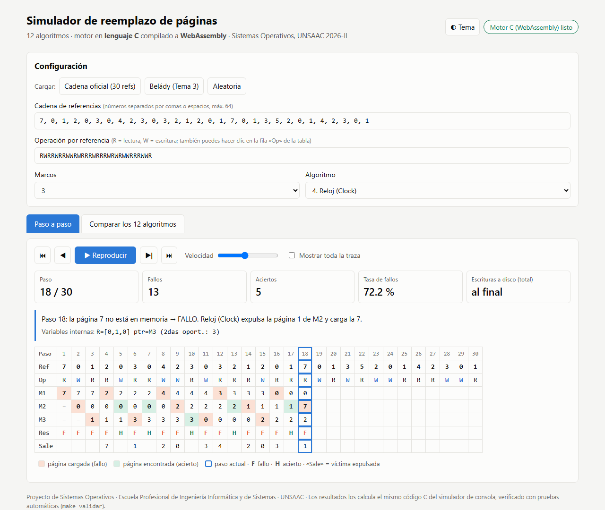
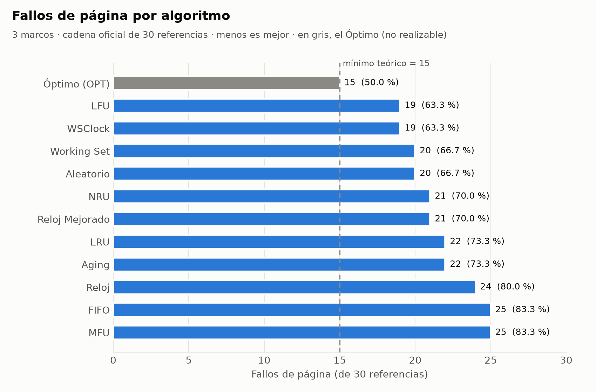

# Algoritmos de Reemplazo de Páginas: Proyecto de Sistemas Operativos

**Universidad Nacional de San Antonio Abad del Cusco**
Escuela Profesional de Ingeniería Informática y de Sistemas
Curso: Sistemas Operativos | Docente: Ing. Emilio Palomino Olivera | Semestre 2026-II

Simulación en C (Linux/POSIX) de **12 algoritmos de reemplazo de páginas** con **3 marcos** y una cadena fija de **30 referencias**.

## Bitácora de avance

| Paso | Descripción | Estado | Documento |
|---|---|---|---|
| 1 | Fijar los parámetros del experimento | ✅ | [docs/PASO_01_parametros.md](docs/PASO_01_parametros.md) |
| 2 | Preparar el entorno Linux (WSL, gcc, make) | ✅ | [docs/PASO_02_entorno.md](docs/PASO_02_entorno.md) |
| 3 | Estructura modular del código en C | ✅ | [docs/PASO_03_estructura.md](docs/PASO_03_estructura.md) |
| 4 | Implementar los 12 algoritmos | ✅ | [docs/PASO_04_algoritmos.md](docs/PASO_04_algoritmos.md) |
| 5 | Validar resultados | ✅ | [docs/PASO_05_validacion.md](docs/PASO_05_validacion.md) |
| 6 | Generar trazas, CSV y gráficas | ✅ | [docs/PASO_06_resultados.md](docs/PASO_06_resultados.md) |
| 7 | Simulador web interactivo (C → WebAssembly) | ✅ | [docs/PASO_07_simulador_web.md](docs/PASO_07_simulador_web.md) |
| 8 | Informe en Word | ✅ | [docs/PASO_08_informe.md](docs/PASO_08_informe.md) |
| 9 | Integración final y entrega | ⏳ | — |

## Estructura del repositorio

```
├── docs/        Documentación de cada paso (+ evidencias/)
├── src/         Código fuente en C (+ Makefile)
├── tests/       Validación: referencia.py y validar.py
├── scripts/     generar_resultados.sh, graficas.py y generar_informe.py
├── resultados/  Trazas (.txt) y métricas (.csv) generadas por el simulador
├── graficas/    Gráficas comparativas (PNG y SVG)
├── web/         Simulador web: motor C compilado a WebAssembly + interfaz
└── informe/     Informe final en Word (.docx) y PDF
```

## Compilar (Linux / WSL)

```bash
cd src
make                  # compila todo en ../build/
make run              # traza de los 12 algoritmos + tabla comparativa
../build/simulador -h # ver todas las opciones (-a, -r, -m, -c, -w, -o, -t, -l)
make test             # prueba de entorno y parámetros
make validar          # validación formal: 67 pruebas (requiere python3)
make resultados       # regenera resultados/ (trazas y CSV)
make web              # compila el motor C a WebAssembly (requiere Emscripten)
make web-servir       # simulador web en http://localhost:8000
make clean
```

Gráficas (requiere matplotlib), desde la raíz: `python scripts/graficas.py`

## Informe

[informe/Informe_Proyecto_SO_Reemplazo_de_Paginas.docx](informe/Informe_Proyecto_SO_Reemplazo_de_Paginas.docx) (28 páginas, centrado en el código de los 12 algoritmos; también en PDF). Se regenera con `python scripts/generar_informe.py`.

## Simulador web



## Resultado principal (3 marcos, 30 referencias)



## Integrantes

1. Angel Ismael Alvarez Catunta (221945)
2. *[Por completar]*
3. *[Por completar]*
4. *[Por completar]*
5. *[Por completar]*
6. *[Por completar]*
