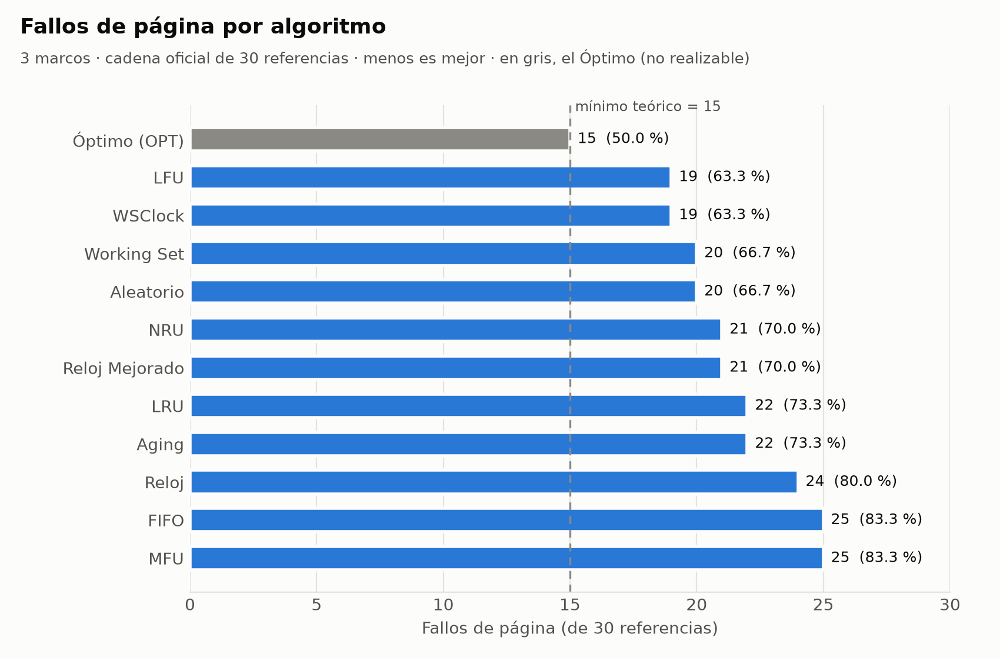
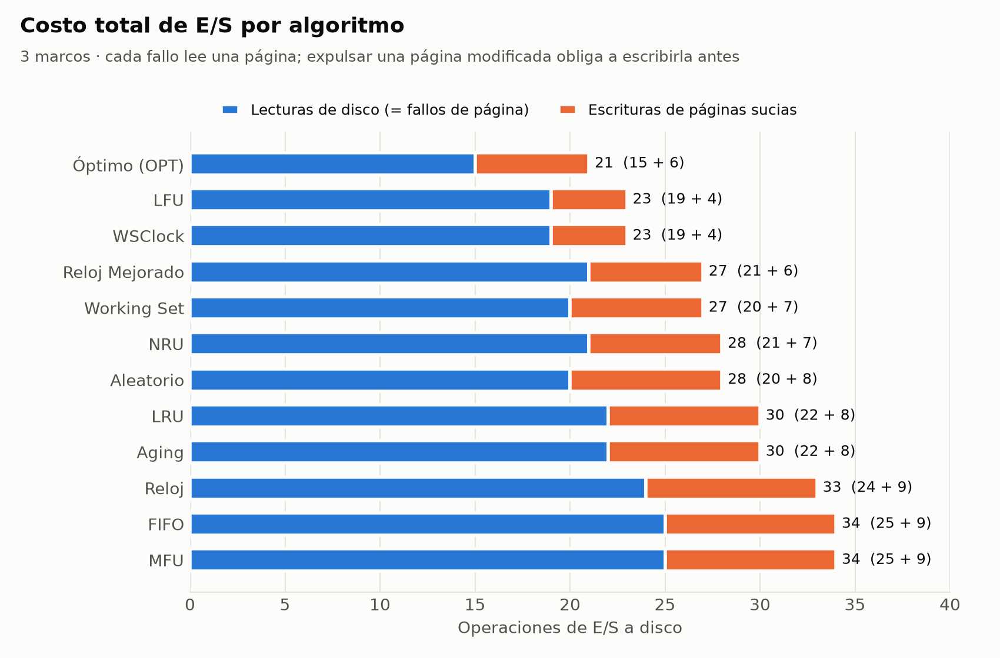
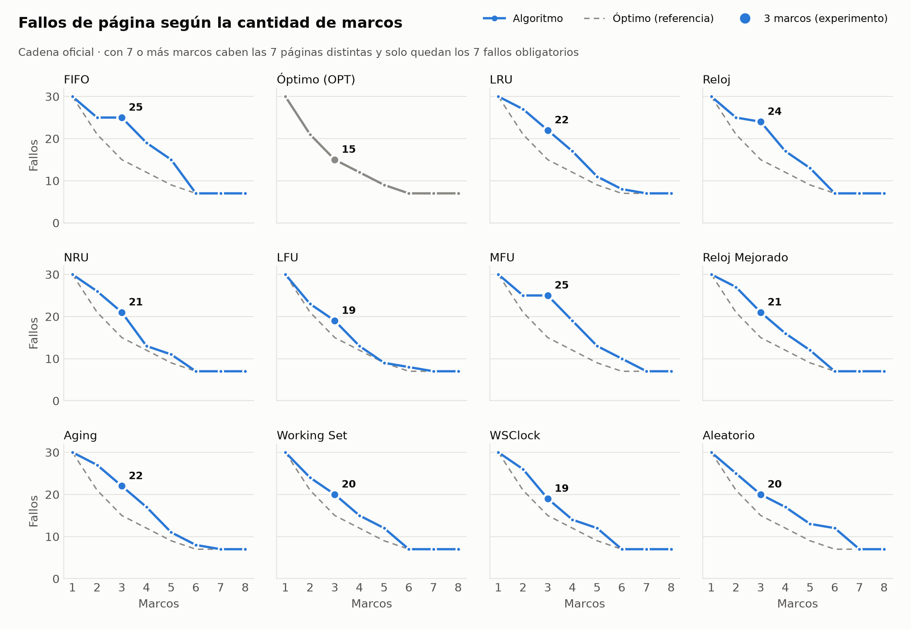
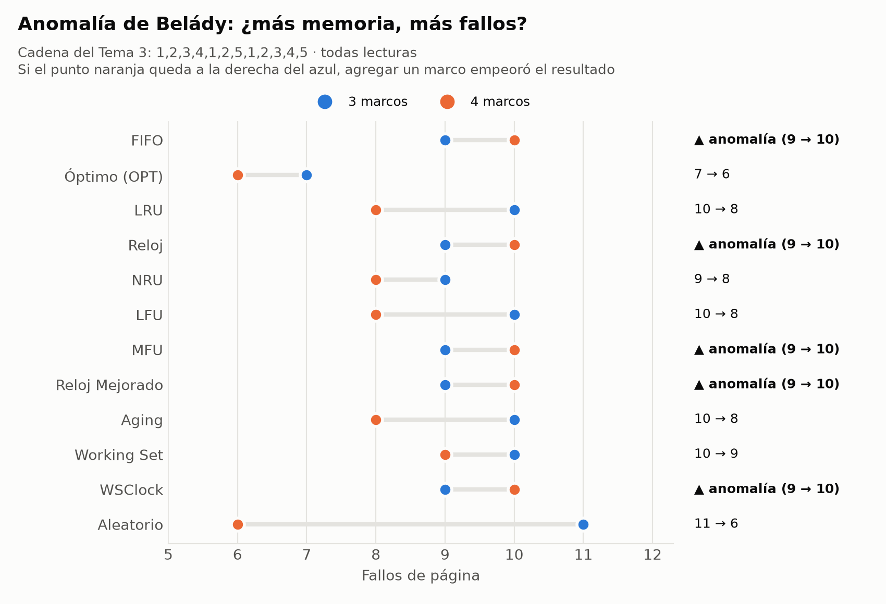

# PASO 6: Trazas, CSV y gráficas (entregables de datos)

> **Estado:** ✅ Completado
> **Archivos generados:** `scripts/generar_resultados.sh`, `scripts/graficas.py`, carpeta `resultados/` (17 archivos) y carpeta `graficas/` (4 gráficas en PNG y SVG)
> **Archivos modificados:** `src/main.c` (opción `-t`), `src/Makefile` (objetivo `resultados`)

## Objetivo

Producir **todos los datos y figuras** que necesita el informe (Paso 7):
- la **traza completa** de cada algoritmo, que el enunciado exige como tabla de 30 pasos;
- las **métricas** en CSV, para tablas y gráficas;
- las **gráficas comparativas**.

**Principio:** todos los números salen del **simulador en C**. Python solo **dibuja** a partir de los CSV que genera el C. Así, si se cambia un algoritmo, se regenera todo con dos comandos y el informe no queda desactualizado.

---

## 6.1 Cómo regenerar todo

```bash
# 1) Datos (Linux / WSL): compila y llena resultados/
cd src && make resultados

# 2) Gráficas (desde la raíz del proyecto; requiere matplotlib)
python scripts/graficas.py          # Windows (ya tiene matplotlib 3.11)
python3 scripts/graficas.py         # Ubuntu (antes: sudo apt install python3-matplotlib)
```

## 6.2 Nueva opción del simulador: `-t` (traza en CSV)

```bash
../build/simulador -t trazas.csv
```
Escribe **una fila por paso y por algoritmo**, con las columnas:
```
ID,Algoritmo,Paso,Pagina,Operacion,M1,M2,M3,Resultado,Victima,Auxiliar
1,"FIFO",1,7,R,7,-,-,F,-,"cola=[7]"
1,"FIFO",2,0,W,7,0,-,F,-,"cola=[7,0]"
```
Con este archivo se arman en Excel, Word o LaTeX las **tablas de 30 pasos** que pide el enunciado para cada algoritmo, sin copiar a mano desde la consola.

## 6.3 Archivos de `resultados/`

| Archivo | Contenido | Uso en el informe |
|---|---|---|
| `salida_consola.txt` | Ejecución completa: trazas de los 12 algoritmos y tabla comparativa | Anexo: evidencia de ejecución en Linux |
| `trazas/01_fifo.txt` … `12_aleatorio.txt` | Traza individual de cada algoritmo | Una por subsección del Capítulo II, para cada integrante |
| `trazas_3marcos.csv` | 360 filas (12 algoritmos × 30 pasos) | Tablas de traza paso a paso |
| `resumen_3marcos.csv` | Fallos, aciertos, tasas y escrituras de los 12 algoritmos | Tabla comparativa general |
| `curva_marcos.csv` | Las mismas métricas con 1 a 8 marcos (96 filas) | Gráfica G3 y análisis de sensibilidad |
| `belady_tema3.csv` | Cadena del Tema 3 con 3 y 4 marcos (24 filas) | Gráfica G4 y anomalía de Belády |

### Resumen del experimento oficial (`resumen_3marcos.csv`)

| ID | Algoritmo | Responsable | Fallos | Aciertos | % Fallos | % Aciertos | Escrituras |
|---|---|---|---|---|---|---|---|
| 1 | FIFO | Elvis Suca | 25 | 5 | 83.33 | 16.67 | 9 |
| 2 | Óptimo (OPT) | Jhamil Huahualuque | 15 | 15 | 50.00 | 50.00 | 6 |
| 3 | LRU | Jhamil Huahualuque | 22 | 8 | 73.33 | 26.67 | 8 |
| 4 | Reloj (Clock) | Haider Carpio | 24 | 6 | 80.00 | 20.00 | 9 |
| 5 | NRU | Angel Alvarez | 21 | 9 | 70.00 | 30.00 | 7 |
| 6 | LFU | Elvis Suca | 19 | 11 | 63.33 | 36.67 | 4 |
| 7 | MFU | Angel Alvarez | 25 | 5 | 83.33 | 16.67 | 9 |
| 8 | Reloj Mejorado | Marcus Meza | 21 | 9 | 70.00 | 30.00 | 6 |
| 9 | Aging | Marcus Meza | 22 | 8 | 73.33 | 26.67 | 8 |
| 10 | Working Set | Elvis Suca | 20 | 10 | 66.67 | 33.33 | 7 |
| 11 | WSClock | Haider Carpio | 19 | 11 | 63.33 | 36.67 | 4 |
| 12 | Aleatorio (RAND) | Jhamil Huahualuque | 20 | 10 | 66.67 | 33.33 | 8 |

## 6.4 Gráficas

Cada gráfica se genera en **PNG a 200 ppp**, para insertar en Word, y en **SVG vectorial**, para LaTeX u Overleaf sin pérdida de calidad.

**Criterios de diseño aplicados:**
- **Un solo eje Y** por gráfica. Fallos y escrituras se suman en una barra apilada, nunca en dos escalas.
- **Pocos colores:** azul para los algoritmos, naranja para la segunda medida y gris para el Óptimo, que es una **referencia teórica** y no un competidor. Son los 3 primeros colores de una paleta probada para personas con daltonismo.
- **Barras ordenadas** de mejor a peor, con el **valor escrito** al final de cada barra para que no haya que adivinarlo con la escala.
- **Un panel por algoritmo** en la curva de marcos, en lugar de 12 líneas encimadas en un solo gráfico.

### G1: Fallos de página por algoritmo


**Lectura:** el Óptimo marca el **mínimo teórico (15)**. Los mejores algoritmos realizables son **LFU y WSClock (19)**, a 4 fallos del ideal. **FIFO y MFU (25)** son los peores, con 10 fallos más que el ideal. Entre el mejor y el peor algoritmo real hay **6 fallos de diferencia**, un 20 % de las referencias.

### G2: Costo total de E/S


**Lectura:** cada fallo es una **lectura** de disco, y expulsar una página modificada suma una **escritura**. Esta gráfica cambia algunas conclusiones de G1:
- **LFU y WSClock** siguen primeros (23 E/S) y además son los que **menos escriben** (4), porque conservan la página 0, la más escrita.
- **Reloj Mejorado (21 + 6 = 27)** supera a **NRU (21 + 7 = 28)** con los mismos fallos: preferir víctimas limpias **ahorra escrituras**, que es justo su objetivo de diseño.
- Hasta el Óptimo hace 6 escrituras: minimizar fallos **no** minimiza automáticamente las escrituras.

### G3: Fallos según la cantidad de marcos


**Lectura:**
- Todas las curvas parten de **30** (1 marco) y terminan en **7** (7 o más marcos: los fallos obligatorios).
- La mayoría cae a 7 ya con **6 marcos**. **LRU, Aging y LFU necesitan 7** (8 fallos con 6 marcos), y **MFU y Aleatorio** también llegan a 7 recién con 7 marcos.
- **FIFO y MFU se estancan de 2 a 3 marcos** (25 → 25): ese marco extra no sirve de nada con esta cadena.
- **NRU con 4 marcos (13)** queda a solo 1 fallo del Óptimo (12) y mejor que LRU (17). El ranking **depende del número de marcos**: no hay un algoritmo "mejor" en todas las condiciones.
- El punto grande marca **3 marcos**, la condición del experimento: es donde las curvas están **más separadas** (de 15 a 25).

### G4: Anomalía de Belády


**Lectura:** con la cadena clásica del Tema 3, **5 algoritmos empeoran al pasar de 3 a 4 marcos** (9 → 10 fallos): FIFO, Reloj, MFU, Reloj Mejorado y WSClock. Los 5 comparten un rasgo: **en algún momento eligen la víctima por orden de llegada o con un puntero circular**. Con esta cadena, ese orden "cae" justo sobre la página que se necesitará después. **Óptimo y LRU (algoritmos de pila)** mejoran, como garantiza la teoría. El Aleatorio mejora mucho (11 → 6), pero por azar de la semilla.

## 6.5 Verificación de consistencia

| Comprobación | Resultado |
|---|---|
| `resumen_3marcos.csv` = tabla del Paso 4 | ✅ idéntica |
| Columna de 3 marcos de `curva_marcos.csv` = `resumen_3marcos.csv` | ✅ |
| `belady_tema3.csv` = tabla V7 del Paso 5 | ✅ |
| `trazas_3marcos.csv`: 360 filas + encabezado; fallos por algoritmo = resumen | ✅ |
| Compilación con la opción `-t` nueva | ✅ 0 advertencias |
| Gráficas revisadas visualmente: sin textos encimados ni recortados | ✅ (se corrigieron 2 detalles: la leyenda de G3 tapaba el subtítulo y el subtítulo de G4 se cortaba) |

## 6.6 Diferencias con el boceto del ZIP

| Boceto | Ahora |
|---|---|
| CSV con valores de otra cadena y otros algoritmos | CSV generados por el simulador validado (Paso 5) |
| 3 gráficas sin trazabilidad (no se sabe cómo se generaron) | 4 gráficas **reproducibles con un comando**, a partir de los CSV |
| Barras de fallos y aciertos en el mismo gráfico (redundante: aciertos = 30 − fallos) | Fallos con referencia al Óptimo, más una gráfica nueva de **costo de E/S** |
| Sin análisis de sensibilidad | **Curva de 1 a 8 marcos** y **Belády** con datos medidos |

---

**Siguiente paso:** PASO 7. Redacción del informe según la estructura del enunciado (carátula, introducción, Capítulos I y II, bibliografía APA 7), usando estas trazas, tablas y gráficas.
