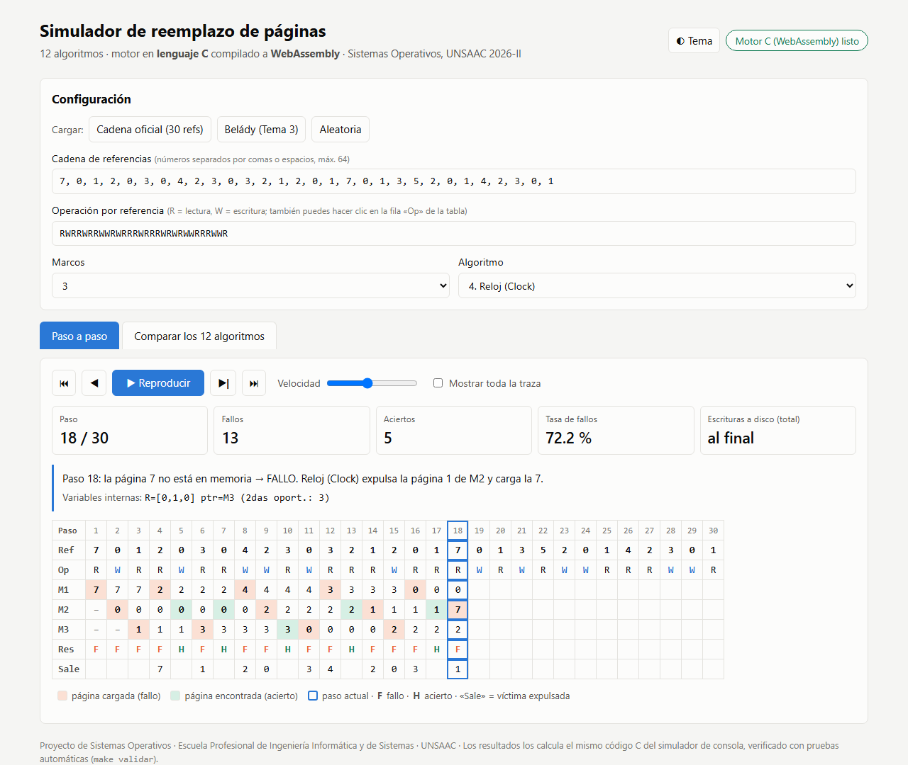
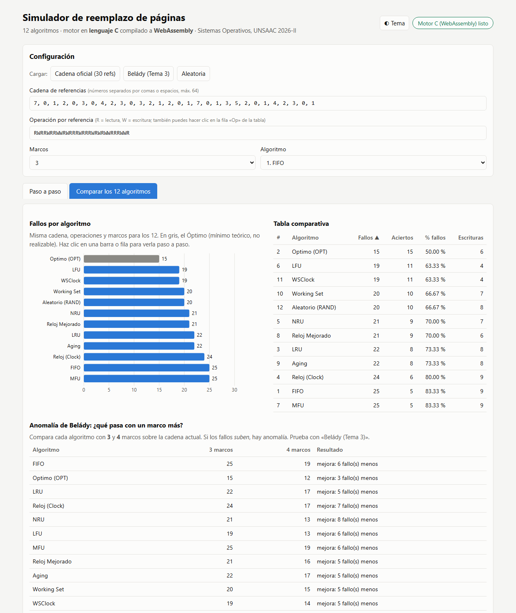

# PASO 7: Simulador web interactivo con el motor en C (WebAssembly)

> **Estado:** ✅ Completado: **67/67 pruebas superadas** (las 63 anteriores + 4 nuevas del motor web)
> **Archivos generados:** `src/web/api_web.c`, `web/index.html`, `web/estilos.css`, `web/app.js`, `web/motor.js`, `web/motor.wasm`, `tests/web_volcado.js`, `docs/img/web_*.png`, `docs/evidencias/validacion_paso07.txt`
> **Archivos modificados:** `src/Makefile` (objetivos `web` y `web-servir`), `tests/validar.py` (grupo V10), `.gitattributes`

## Objetivo

Ofrecer un **simulador interactivo en el navegador**, como el simulador web que menciona el boceto del ZIP, pero **sin reescribir los algoritmos en JavaScript**. La página ejecuta **el mismo código C** del simulador de consola, compilado a **WebAssembly**.

---

## 7.1 Arquitectura: un solo código C, dos programas

```
                         src/algoritmos/*.c   comun.c   algoritmos.c   parametros.c
                         (los 12 algoritmos: SIN CAMBIOS, validados en el Paso 5)
                                     │                         │
                         + main.c    │                         │   + web/api_web.c
                                     ▼                         ▼
                              gcc (Linux)               emcc (Emscripten)
                                     │                         │
                                     ▼                         ▼
                        build/simulador (consola)     web/motor.wasm (21 KB) + motor.js
                                                               │
                                                               ▼
                                             web/index.html + app.js (solo dibuja)
```

| Capa | Archivo | Responsabilidad |
|---|---|---|
| Algoritmos | `src/algoritmos/*.c`, `comun.c` | Toda la lógica de reemplazo, **la misma** que usa la consola |
| Puente C ↔ web | `src/web/api_web.c` | Recibe la cadena, ejecuta un algoritmo y expone la traza paso a paso |
| Motor compilado | `web/motor.wasm` + `web/motor.js` | Código máquina de WebAssembly y el cargador que genera Emscripten |
| Interfaz | `web/app.js`, `index.html`, `estilos.css` | Lee entradas, llama al motor y dibuja. **No contiene ningún algoritmo.** |

### Funciones que exporta `api_web.c`

| Función | Uso |
|---|---|
| `web_fijar_ref(i, pagina)`, `web_fijar_escritura(i, w)` | Cargar la cadena y el patrón R/W |
| `web_simular(id, n, marcos)` | Ejecutar el algoritmo `id` (1–12); devuelve los fallos o −1 si la entrada es inválida |
| `web_marco(paso, k)`, `web_marco_cargado(paso)`, `web_victima(paso)`, `web_aux(paso)` | Leer la traza: contenido de cada marco, marco cargado, víctima y variables internas |
| `web_fallos()`, `web_aciertos()`, `web_escrituras()` | Métricas finales |
| `web_nombre_algoritmo(id)`, `web_ref_oficial(i)`, `web_escritura_oficial(i)`, … | Datos para la interfaz (nombres, cadena oficial) |

`api_web.c` también compila con `gcc` sin advertencias: el código es C estándar y solo usa la macro `EMSCRIPTEN_KEEPALIVE` cuando se compila con Emscripten.

## 7.2 Funciones del simulador

### Configuración
- Cadena de referencias (hasta 64) y operación por referencia (R/W). La operación también se cambia **haciendo clic** en la fila «Op» de la tabla.
- De 1 a 8 marcos y cualquiera de los 12 algoritmos.
- Cadenas predefinidas: **oficial** (30 referencias con su patrón R/W), **Belády (Tema 3)** y **aleatoria**.

### Paso a paso


- Controles: inicio, anterior, **reproducir/pausa**, siguiente y final, con control de **velocidad**. Teclado: `←` `→` `espacio` `Inicio` `Fin`.
- Matriz marcos × pasos: en **naranja** la página cargada (fallo), en **verde** la página encontrada (acierto), con recuadro el paso actual y la fila «Sale» con la víctima. Las columnas futuras se ocultan, salvo que se marque «Mostrar toda la traza».
- Indicadores acumulados hasta el paso actual: fallos, aciertos y tasa de fallos.
- **Explicación en lenguaje natural** de cada paso, por ejemplo: *«Paso 18: la página 7 no está en memoria → FALLO. Reloj (Clock) expulsa la página 1 de M2 y carga la 7.»*
- **Variables internas** del algoritmo en ese paso: `R=[0,1,0] ptr=M3 (2das oport.: 3)`.

### Comparar los 12 algoritmos


- Gráfico de barras de fallos, con el Óptimo en gris como referencia, y tabla ordenable con fallos, aciertos, % de fallos y escrituras. **Al hacer clic** en una barra o fila se abre ese algoritmo paso a paso.
- **Prueba de Belády:** cada algoritmo con *m* y *m* + 1 marcos sobre la cadena actual, marcando «▲ anomalía» si los fallos suben.

### Otros detalles
- **Tema claro/oscuro**: sigue al sistema y tiene un botón para cambiarlo.
- **Enlaces directos a un estado**, útiles para compartir o para capturas:
  `?alg=4&paso=18` · `?preset=belady&vista=comparar` · `?tema=claro` · `?marcos=4&revelar=1`
- Diseño adaptable a pantallas angostas: la matriz se desplaza dentro de su propio recuadro.

## 7.3 Cómo compilar y ejecutar

**Requisito único (una vez):** instalar Emscripten en WSL. No requiere contraseña.
```bash
cd ~ && git clone --depth 1 https://github.com/emscripten-core/emsdk.git
cd emsdk && ./emsdk install latest && ./emsdk activate latest
```
Versión usada: **Emscripten 7.0.0** (incluye Node.js 24.19).

```bash
cd src
make web          # compila el C a web/motor.wasm (carga ~/emsdk automáticamente)
make web-servir   # sirve la carpeta web/ en http://localhost:8000
```

> ⚠️ **No funciona abriendo `index.html` con doble clic.** Los navegadores bloquean la carga de WebAssembly desde `file://`; hace falta un servidor (`make web-servir`). La página lo detecta y muestra cómo arreglarlo.

`web/motor.js` y `web/motor.wasm` **se suben al repositorio**. Así, para *usar* el simulador basta un servidor estático, sin Emscripten. Emscripten solo hace falta para *recompilar* tras cambiar el C.

Comando de compilación (desde el Makefile):
```bash
emcc -std=c11 -Wall -Wextra -pedantic -O2 \
     -sMODULARIZE=1 -sEXPORT_NAME=crearMotor -sENVIRONMENT=web,node \
     -sEXPORTED_RUNTIME_METHODS=ccall,cwrap,UTF8ToString \
     -o ../web/motor.js web/api_web.c algoritmos.c parametros.c comun.c algoritmos/*.c
```
Compila **sin advertencias**, con las mismas opciones estrictas que la versión de consola.

## 7.4 Validación del motor web (grupo V10)

`make validar` incluye ahora el grupo **V10**:
- `tests/web_volcado.js` carga `motor.wasm` en **Node.js** y ejecuta los 12 algoritmos.
- `validar.py` compara cada traza con la implementación de referencia del Paso 5, revisando marcos, F/H, fallos, aciertos y escrituras.

| Prueba V10 | Resultado |
|---|---|
| El motor WebAssembly carga y responde en Node.js | ✅ |
| Cadena oficial con 1 a 8 marcos: **96 trazas idénticas** | ✅ |
| Belády (Tema 3) y **300 cadenas al azar**: trazas idénticas | ✅ |
| Valores de control desde WebAssembly (FIFO 25, OPT 15, LRU 22, Reloj 24) | ✅ |

**Total: 67/67 pruebas superadas.** Si en un equipo no están instalados Node.js o el motor, V10 se marca como «OMITIDO» y no se cuenta. Salida completa en [`docs/evidencias/validacion_paso07.txt`](evidencias/validacion_paso07.txt).

**Revisión visual:** la página se abrió en Microsoft Edge (modo headless) con tema claro y oscuro, a 1280 px y a 600 px de ancho. En el paso 18 de Reloj y en el paso 22 de WSClock, los valores y las variables internas coinciden con las trazas de `resultados/trazas/`.

## 7.5 Publicarlo en internet (opcional)

La carpeta `web/` es un **sitio estático**: no necesita servidor propio.
- **Vercel o Netlify** (gratis, sirven para repositorios privados): importar el repositorio y configurar *Output/Publish directory* = `web` y *Build command* vacío.
- **GitHub Pages:** solo es gratis con el repositorio **público**.

## 7.6 Problemas encontrados

| Problema | Solución |
|---|---|
| Los permisos de la sesión bloquearon la descarga automática de Emscripten (código externo) | El usuario ejecutó el instalador oficial manualmente |
| Advertencia `-Wcomment` por escribir `algoritmos/*.c` dentro de un comentario | Se reescribió el comentario |
| Las capturas a 400 px salían recortadas | Es el ancho mínimo del navegador en modo headless, no un fallo de la página: a 600 px se ve correcta |

---

**Siguiente paso:** PASO 8. Informe en Word (carátula, introducción, Capítulos I y II, bibliografía APA 7), con una sección sobre este simulador web y sus capturas.
